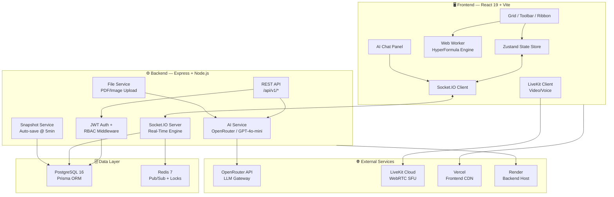
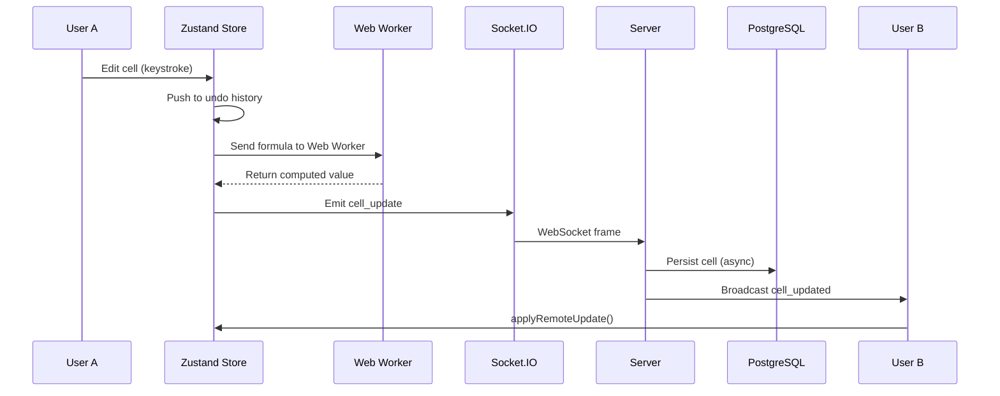
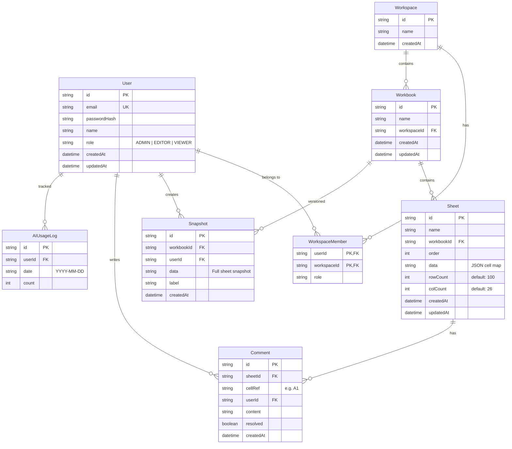
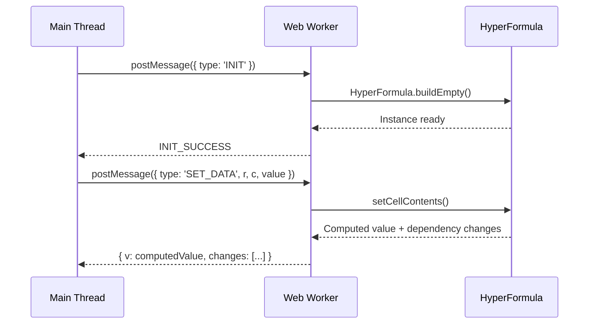
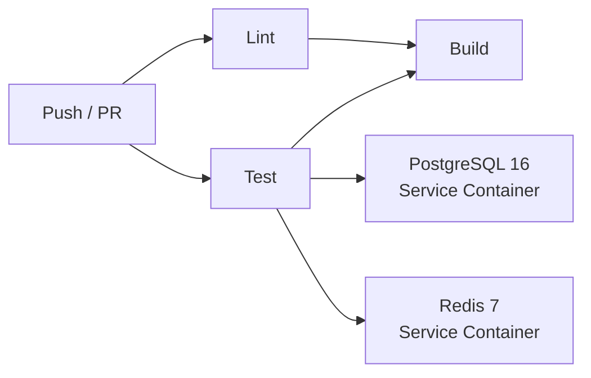

<div align="center">

# 📊 Dora Sheet

### The AI-Native Collaborative Spreadsheet Platform

[](https://github.com/narwal4421/dora-sheet/actions)
[](https://typescriptlang.org)
[](https://react.dev)
[](https://nodejs.org)
[](https://prisma.io)
[](https://socket.io)
[](LICENSE)
[](https://dora-sheet.vercel.app)

**Dora Sheet** is a full-stack, real-time collaborative spreadsheet application powered by an AI assistant, built-in video/voice calling, cinematic dashboards, and a professional formula engine. Think *Google Sheets meets ChatGPT* — open source and free.

[🚀 Live Demo](https://dora-sheet.vercel.app) · [📖 API Docs](https://dora-sheet-api.onrender.com/api/docs) · [🐛 Report Bug](https://github.com/narwal4421/dora-sheet/issues) · [💡 Request Feature](https://github.com/narwal4421/dora-sheet/issues)

---


</div>

---

## 📋 Table of Contents

- [✨ Features](#-features)
- [🏗️ System Architecture](#️-system-architecture)
- [📁 Project Structure](#-project-structure)
- [🛠️ Tech Stack](#️-tech-stack)
- [⚡ Quick Start](#-quick-start)
- [🔧 Environment Variables](#-environment-variables)
- [🗄️ Database Schema](#️-database-schema)
- [🔌 API Reference](#-api-reference)
- [🌐 Real-Time Protocol](#-real-time-protocol)
- [🤖 AI Engine](#-ai-engine)
- [📐 Formula Engine](#-formula-engine)
- [🧪 Testing](#-testing)
- [🚀 Deployment](#-deployment)
- [📊 Performance](#-performance)
- [🤝 Contributing](#-contributing)
- [📄 License](#-license)

---

## ✨ Features

### 🧠 AI-Powered Intelligence
| Feature | Description |
|---------|-------------|
| **Natural Language Formulas** | Ask in plain English — get precise spreadsheet formulas (SUM, VLOOKUP, IF, SUMIF, etc.) |
| **PDF / Image Extraction** | Upload PDFs or images → structured table data extracted directly into the grid |
| **Cinematic Dashboards** | AI generates KPI cards + interactive charts (bar, line, area, pie) from your data |
| **Semantic Search** | Search your data using natural language queries |
| **Data Analysis** | Deep insights, anomaly detection, and actionable suggestions |
| **Smart Templates** | 9 built-in templates: Budget, Invoice, CRM, Payroll, Project Tracker, and more |
| **Auto-Formatting** | AI-driven cell styling — bold, colors, alignment, number formats |
| **Multilingual Support** | Auto-detects user language; normalizes non-English input to structured data |

### 👥 Real-Time Collaboration
| Feature | Description |
|---------|-------------|
| **Live Cursors** | See every collaborator's cursor position in real-time with colored indicators |
| **Cell Locking** | Automatic pessimistic locking prevents editing conflicts |
| **Presence Awareness** | Live user list showing who's online with colored avatars |
| **Team Chat** | In-workbook chat with message deduplication and history |
| **Room Lock & Access Control** | Host can lock rooms; join-request/approval flow for new users |
| **Host Handover** | Automatic host reassignment when the original host disconnects |

### 📞 Voice & Video Calls
| Feature | Description |
|---------|-------------|
| **Built-in Calling** | Voice and video calls powered by LiveKit — no Zoom needed |
| **Incoming Call UI** | Rich incoming call overlay with accept/decline actions |
| **Active Call HUD** | Persistent call overlay during active collaboration sessions |

### 📈 Spreadsheet Engine
| Feature | Description |
|---------|-------------|
| **100+ Formulas** | Powered by HyperFormula — SUM, AVERAGE, VLOOKUP, INDEX/MATCH, and more |
| **Web Worker Execution** | Formula calculations run off the main thread for zero UI blocking |
| **Multi-Sheet Workbooks** | Add, rename, delete, and switch between multiple sheet tabs |
| **50-Level Undo/Redo** | Deep history stack with intelligent state snapshots |
| **Find & Replace** | Full-workbook search with result navigation |
| **Cell Formatting** | Bold, italic, underline, font size, colors, alignment, borders, number formats |
| **Merged Cells** | Merge and unmerge cell ranges across rows and columns |
| **Freeze Panes** | Freeze rows/columns for header pinning during scroll |
| **Column/Row Resizing** | Drag-to-resize with auto-fit support |
| **Sort & Filter** | Ascending/descending sort per column with row hiding |
| **Excel Import/Export** | Drag-and-drop `.xlsx`/`.xls`/`.csv`/`.tsv` import; export to `.xlsx` |
| **Version History** | Auto-snapshots every 5 minutes + manual save points with restore |
| **Virtual Scrolling** | Handles 1000+ rows × 100+ columns with constant rendering performance |
| **Format Painter** | Copy formatting from one cell and apply to others (single or persistent mode) |
| **Context Menu** | Right-click menu with cut/copy/paste, insert/delete rows/columns |
| **Keyboard Shortcuts** | Ctrl+Z, Ctrl+Y, Ctrl+C/V/X, Ctrl+O, Alt+C, and more |

---

## 🏗️ System Architecture



### Request Flow — Cell Edit Propagation



---

## 📁 Project Structure

```
dora-sheet/
├── .github/
│   └── workflows/
│       └── ci.yml                    # GitHub Actions: lint → test → build
├── apps/
│   ├── api/                          # 🔧 Express.js Backend
│   │   ├── prisma/
│   │   │   └── schema.prisma         # Database schema (7 models)
│   │   ├── src/
│   │   │   ├── index.ts              # Server entrypoint + auto-snapshot scheduler
│   │   │   ├── config/
│   │   │   │   ├── env.ts            # Zod-validated environment config
│   │   │   │   ├── logger.ts         # Winston structured logging
│   │   │   │   ├── prisma.ts         # Prisma client singleton
│   │   │   │   └── redis.ts          # Redis/IORedis connection
│   │   │   ├── middleware/
│   │   │   │   ├── auth.middleware.ts # JWT authentication guard
│   │   │   │   ├── rbac.middleware.ts # Role-based access control
│   │   │   │   ├── rateLimiter.ts    # API + Auth rate limiting
│   │   │   │   └── error.middleware.ts# Global error handler
│   │   │   ├── modules/
│   │   │   │   ├── ai/               # AI chat, tool-calling, prompt engineering
│   │   │   │   ├── auth/             # Registration, login, JWT refresh
│   │   │   │   ├── call/             # LiveKit video/voice token generation
│   │   │   │   ├── file/             # File upload (Multer) + PDF/image processing
│   │   │   │   ├── workbook/         # Workbook + Sheet CRUD + Snapshots
│   │   │   │   └── workspace/        # Workspace + Member management
│   │   │   └── sockets/
│   │   │       └── socket.server.ts  # Real-time WebSocket engine (362 lines)
│   │   └── tests/
│   │       ├── setup.ts              # Test harness setup
│   │       └── api.test.ts           # Integration tests
│   │
│   └── web/                          # 🎨 React 19 Frontend
│       ├── public/                   # Static assets (favicon, icons)
│       ├── src/
│       │   ├── App.tsx               # Root orchestrator (420 lines)
│       │   ├── components/
│       │   │   ├── Grid.tsx          # Virtual-scrolling spreadsheet grid
│       │   │   ├── Cell.tsx          # Individual cell renderer + editor
│       │   │   ├── Toolbar.tsx       # Classic toolbar (bold, italic, etc.)
│       │   │   ├── TopNav.tsx        # Top navigation bar
│       │   │   ├── FormulaBar.tsx    # Excel-style formula bar
│       │   │   ├── AIChatPanel.tsx   # AI assistant chat interface
│       │   │   ├── SheetTabs.tsx     # Multi-sheet tab bar
│       │   │   ├── FindReplace.tsx   # Find & Replace dialog
│       │   │   ├── ContextMenu.tsx   # Right-click context menu
│       │   │   ├── ChartOverlay.tsx  # Chart rendering overlay
│       │   │   ├── DashboardOverlay.tsx # Cinematic dashboard view
│       │   │   ├── VersionHistory.tsx   # Snapshot timeline viewer
│       │   │   ├── DropdownMenu.tsx  # Reusable dropdown component
│       │   │   ├── AboutPage.tsx     # About / landing page
│       │   │   ├── ToastContainer.tsx# Toast notification system
│       │   │   ├── Ribbon/
│       │   │   │   └── Ribbon.tsx    # Office-style ribbon with tabs
│       │   │   ├── Grid/
│       │   │   │   ├── GridHeaders.tsx      # Row/column headers
│       │   │   │   ├── RemoteCursorsLayer.tsx # Live cursor rendering
│       │   │   │   └── SelectionOverlay.tsx  # Selection highlight
│       │   │   ├── Collaboration/
│       │   │   │   ├── JoinIdentityModal.tsx # User identity prompt
│       │   │   │   ├── JoinRequestStack.tsx  # Join request notifications
│       │   │   │   └── RoomLockedModal.tsx   # Room lock gate
│       │   │   └── Modals/
│       │   │       ├── ShareModal.tsx        # Share link + room controls
│       │   │       ├── ChartModal.tsx        # Chart creation wizard
│       │   │       ├── TemplatesModal.tsx    # Template gallery
│       │   │       ├── CalculatorModal.tsx   # Built-in calculator
│       │   │       ├── IncomingCallOverlay.tsx # Call notification
│       │   │       └── ActiveCallOverlay.tsx  # Active call HUD
│       │   ├── hooks/
│       │   │   ├── useSEOMetadata.ts    # Dynamic meta tag injection
│       │   │   └── useVirtualizerWrapper.ts # Virtual scroll hook
│       │   ├── services/
│       │   │   ├── socket.service.ts    # Socket.IO client (singleton, 385 lines)
│       │   │   ├── auth.service.ts      # Auth API client
│       │   │   └── formulaService.ts    # Formula engine bridge
│       │   ├── store/
│       │   │   ├── useSheetStore.ts     # Core state machine (1769 lines)
│       │   │   ├── useCallStore.ts      # Call/video state
│       │   │   └── useToastStore.ts     # Toast notification state
│       │   └── utils/
│       │       ├── excelImporter.ts     # XLSX/CSV/TSV import parser
│       │       └── workbookUrl.ts       # URL ↔ Workbook ID utilities
│       ├── index.html                   # SEO-optimized entry (JSON-LD, OG tags)
│       ├── tailwind.config.js           # Custom dark theme + design tokens
│       └── vite.config.ts               # Vite + manual chunk splitting
│
├── packages/
│   ├── formula-engine/               # 📐 HyperFormula Web Worker
│   │   ├── src/
│   │   │   ├── index.ts              # EngineWrapper (async message bridge)
│   │   │   └── formula.worker.ts     # Worker thread (HyperFormula instance)
│   │   └── tests/
│   │       └── formula.test.ts       # Formula engine unit tests
│   │
│   └── types/                        # 📦 Shared TypeScript Types
│       └── src/
│           ├── index.ts              # Barrel export
│           ├── cell.types.ts         # CellData, CellFormat, SheetData, SheetMeta
│           ├── api.types.ts          # APIResponse, APIError, JWTPayload
│           └── socket.types.ts       # CellUpdateEvent, CursorMoveEvent, CellLockEvent
│
├── docker-compose.yml                # PostgreSQL 16 + Redis 7 services
├── vercel.json                       # Vercel SPA rewrite rules
├── package.json                      # Root monorepo (npm workspaces)
└── .env.example                      # Environment variable template
```

---

## 🛠️ Tech Stack

### Frontend
| Technology | Purpose |
|------------|---------|
| **React 19** | UI framework with hooks, suspense, and concurrent rendering |
| **Vite 8** | Next-gen build tool with HMR and optimized chunking |
| **TypeScript 6** | End-to-end type safety |
| **Zustand 5** | Lightweight state management with selector pattern |
| **Tailwind CSS 4** | Utility-first styling with custom design tokens |
| **Socket.IO Client** | WebSocket transport with auto-reconnection |
| **TanStack Virtual** | Virtualized scrolling for massive grids |
| **ECharts 6** | Interactive charts and data visualization |
| **GSAP 3** | Premium animations (toasts, overlays, transitions) |
| **LiveKit Client** | WebRTC-based voice and video calls |
| **Lucide React** | Beautiful icon library |
| **SheetJS (xlsx)** | Excel file import/export |
| **Howler.js** | Sound effects and audio feedback |

### Backend
| Technology | Purpose |
|------------|---------|
| **Node.js 20** | JavaScript runtime |
| **Express 4** | HTTP framework with middleware pipeline |
| **Socket.IO 4** | Real-time bidirectional event-based communication |
| **Prisma 5** | Type-safe ORM with migration support |
| **PostgreSQL 16** | Primary relational database |
| **Redis 7** | Session state, cell locks, room management, pub/sub |
| **OpenRouter (GPT-4o-mini)** | LLM gateway for AI assistant |
| **LiveKit Server SDK** | Video/voice room token generation |
| **Puppeteer** | Server-side rendering for PDF processing |
| **Winston** | Structured logging with file transports |
| **Zod** | Runtime schema validation (env vars, request bodies) |
| **Helmet** | HTTP security headers |
| **express-rate-limit** | API throttling and abuse prevention |
| **bcrypt.js** | Password hashing |
| **jsonwebtoken** | JWT access + refresh token management |
| **Swagger / OpenAPI** | Auto-generated API documentation |

### Shared Packages
| Package | Purpose |
|---------|---------|
| **@smartsheet-ai/types** | Shared TypeScript interfaces (CellData, APIResponse, SocketEvents) |
| **@smartsheet-ai/formula-engine** | HyperFormula-based formula computation in a Web Worker |

### Infrastructure
| Technology | Purpose |
|------------|---------|
| **Vercel** | Frontend hosting with edge CDN |
| **Render** | Backend hosting with managed PostgreSQL |
| **GitHub Actions** | CI/CD pipeline (lint → test → build) |
| **Docker Compose** | Local development (Postgres + Redis) |

---

## ⚡ Quick Start

### Prerequisites

- **Node.js** ≥ 20.x
- **npm** ≥ 10.x
- **Docker** & **Docker Compose** (for local databases)
- **Git**

### 1. Clone the Repository

```bash
git clone https://github.com/narwal4421/dora-sheet.git
cd dora-sheet
```

### 2. Install Dependencies

```bash
npm install
```

### 3. Start Local Databases

```bash
docker compose up -d
```

This starts:
- **PostgreSQL 16** on `localhost:5432`
- **Redis 7** on `localhost:6379`

### 4. Configure Environment

```bash
# Copy the example env file
cp .env.example apps/api/.env
cp .env.example apps/web/.env
```

Edit `apps/api/.env` with your actual keys (see [Environment Variables](#-environment-variables)).

### 5. Initialize the Database

```bash
cd apps/api
npx prisma db push
npx prisma generate
cd ../..
```

### 6. Build Shared Packages

```bash
npm run build --workspace=packages/types
npm run build --workspace=packages/formula-engine
```

### 7. Start Development Servers

```bash
# Terminal 1 — API Server (port 3002)
npm run dev --workspace=apps/api

# Terminal 2 — Web Client (port 5173)
npm run dev --workspace=apps/web
```

### 8. Open in Browser

```
http://localhost:5173
```

> **Tip:** Share the URL `http://localhost:5173/workbook/<any-id>` with another browser tab to test real-time collaboration.

---

## 🔧 Environment Variables

### Backend (`apps/api/.env`)

| Variable | Required | Default | Description |
|----------|----------|---------|-------------|
| `DATABASE_URL` | ✅ | — | PostgreSQL connection string |
| `REDIS_URL` | ❌ | — | Redis connection string (in-memory mock if absent) |
| `JWT_SECRET` | ✅ | — | Secret for signing access tokens (≥ 32 chars) |
| `JWT_REFRESH_SECRET` | ✅ | — | Secret for refresh tokens (≥ 32 chars) |
| `OPENAI_API_KEY` | ❌ | — | OpenRouter API key for AI features |
| `GEMINI_API_KEY` | ❌ | — | Google Gemini API key (alternative AI) |
| `LIVEKIT_API_KEY` | ❌ | — | LiveKit key for video/voice calls |
| `LIVEKIT_API_SECRET` | ❌ | — | LiveKit secret for token signing |
| `LIVEKIT_URL` | ❌ | — | LiveKit WebSocket URL |
| `PORT` | ❌ | `3001` | API server port |
| `NODE_ENV` | ❌ | `development` | Runtime environment |
| `CORS_ORIGIN` | ❌ | `*` | Allowed CORS origin |
| `PUPPETEER_EXECUTABLE_PATH` | ❌ | auto-detect | Chrome binary path for Puppeteer |

### Frontend (`apps/web/.env`)

| Variable | Required | Default | Description |
|----------|----------|---------|-------------|
| `VITE_API_URL` | ❌ | `http://localhost:3002` | Backend API URL |
| `VITE_WS_URL` | ❌ | `ws://localhost:3002` | WebSocket URL |
| `VITE_LIVEKIT_URL` | ❌ | — | LiveKit cloud WebSocket URL |

---

## 🗄️ Database Schema

The application uses **7 Prisma models** backed by PostgreSQL:



### Cell Data Format

Each cell is stored as a JSON object within the sheet's `data` field:

```typescript
// Key pattern: "r_{row}_c_{col}"
{
  "r_0_c_0": {
    "v": "Revenue",              // Raw displayed value
    "f": null,                   // Formula (e.g., "=SUM(B2:B10)")
    "fmt": {                     // Formatting
      "bold": true,
      "backgroundColor": "#107c41",
      "color": "#ffffff",
      "align": "center"
    }
  }
}
```

---

## 🔌 API Reference

The API is versioned at `/api/v1` with full Swagger documentation available at [`/api/docs`](https://dora-sheet-api.onrender.com/api/docs).

| Method | Endpoint | Auth | Description |
|--------|----------|------|-------------|
| `GET` | `/api/v1/health` | ❌ | Health check + uptime |
| **Auth** | | | |
| `POST` | `/api/v1/auth/register` | ❌ | User registration |
| `POST` | `/api/v1/auth/login` | ❌ | Login → JWT tokens |
| `POST` | `/api/v1/auth/refresh` | 🔑 | Refresh access token |
| **Workspaces** | | | |
| `GET` | `/api/v1/workspaces` | 🔑 | List user workspaces |
| `POST` | `/api/v1/workspaces` | 🔑 | Create workspace |
| `POST` | `/api/v1/workspaces/:id/members` | 🔑 | Add member (RBAC) |
| **Workbooks** | | | |
| `GET` | `/api/v1/workbooks` | 🔑 | List workbooks |
| `POST` | `/api/v1/workbooks` | 🔑 | Create workbook |
| `GET` | `/api/v1/workbooks/:id` | 🔑 | Get workbook + sheets |
| `GET` | `/api/v1/workbooks/:id/snapshots` | 🔑 | Version history |
| `POST` | `/api/v1/workbooks/:id/snapshots` | 🔑 | Create snapshot |
| `POST` | `/api/v1/workbooks/:id/restore` | 🔑 | Restore from snapshot |
| **AI** | | | |
| `POST` | `/api/v1/ai/chat` | 🔑 | AI assistant (tool-calling) |
| **Files** | | | |
| `POST` | `/api/v1/upload` | 🔑 | Upload PDF/image for extraction |
| **Calls** | | | |
| `POST` | `/api/v1/call/token` | 🔑 | Generate LiveKit room token |

### Rate Limits

| Scope | Window | Max Requests |
|-------|--------|-------------|
| General API | 15 minutes | 100 |
| Auth endpoints | 1 hour | 100 |
| WebSocket connections | 1 minute | 50 per IP |

---

## 🌐 Real-Time Protocol

The WebSocket layer handles all collaborative features through a structured event system:

### Client → Server Events

| Event | Payload | Description |
|-------|---------|-------------|
| `join_workbook` | `{ workbookId, name }` | Join a collaboration room |
| `cell_update` | `{ sheetId, cellKey, cell }` | Single cell change |
| `bulk_cell_update` | `{ sheetId, updates }` | Batch cell changes |
| `cursor_move` | `{ sheetId, row, col, color, selectionRange }` | Cursor position broadcast |
| `cell_lock` | `{ cellKey, action }` | Lock/unlock cell for editing |
| `chat_message` | `{ message, userName }` | Team chat message |
| `sheet_action` | `{ action, index, ... }` | Structural changes (insert/delete/sort/rename) |
| `toggle_room_lock` | `{ workbookId, locked }` | Lock/unlock room (host only) |
| `request_to_join` | `{ targetRoomId, userInfo }` | Request access to locked room |
| `respond_to_join` | `{ requesterSocketId, approved }` | Accept/deny join request (host only) |
| `start_call` | `{ callerName, video, audio }` | Initiate video/voice call |
| `update_user_name` | `{ name }` | Update display name |

### Server → Client Events

| Event | Payload | Description |
|-------|---------|-------------|
| `cell_updated` | `{ sheetId, cellKey, cell, userId }` | Remote cell change |
| `bulk_cell_updated` | `{ updates, sheetId }` | Remote batch changes |
| `cursor_moved` | `{ userId, row, col, color, selectionRange }` | Remote cursor position |
| `cell_locked` | `{ userId, cellKey, action }` | Lock status changed |
| `user_joined` | `{ userId, name, color, isHost }` | New user joined |
| `user_left` | `{ userId }` | User disconnected |
| `host_changed` | `{ newHostId }` | Host reassignment |
| `room_lock_status` | `{ locked }` | Room lock toggled |
| `chat_message_received` | `{ userName, message, timestamp }` | Incoming chat |
| `incoming_call` | `{ callerName, video, audio }` | Incoming call notification |
| `sheet_action_received` | `{ action, ... }` | Remote structural change |

### Security Measures

- **Connection Rate Limiting:** Max 50 connections per IP per minute
- **JWT Authentication:** Token verified on socket handshake (guest fallback supported)
- **Input Sanitization:** All string payloads HTML-escaped; max 500 chars per field
- **Payload Size Limits:** Configurable caps on grid updates, chat messages, and join requests
- **Structured Security Logging:** All sensitive actions logged with `[SHIELD]` prefix
- **Atomic Host Assignment:** Redis `SET NX` prevents race conditions in host election

---

## 🤖 AI Engine

The AI assistant ("Dora AI") is powered by **GPT-4o-mini** via the **OpenRouter** gateway and uses OpenAI's **function calling** (tool use) to interact with the spreadsheet.

### Available AI Tools

| Tool | Description |
|------|-------------|
| `apply_formula` | Generate and place a spreadsheet formula |
| `fill_data` | Insert structured data (vertical/horizontal layout) |
| `format_cells` | Apply formatting (bold, colors, alignment) |
| `clear_data` | Clear cells atomically (full sheet, range, or selection) |
| `modify_structure` | Insert/delete rows and columns |
| `organize_data` | Sort and filter operations |
| `semantic_search` | Natural language data search |
| `generate_dashboard` | Create KPI + chart dashboards |
| `extract_to_table` | Extract data from PDF/images into grid |
| `analyze_data` | Deep data analysis with suggestions |

### AI Decision Hierarchy

The AI follows a strict 20-step decision hierarchy to route every user message:

```
1. Bug report?        → Error Handling Mode
2. Casual talk?       → Conversation Mode (NO tool calls)
3. Explain formula?   → Explain Mode (text only)
4. Undo request?      → "Press Ctrl+Z" (NO tool calls)
5. Math/formula?      → apply_formula
6. File attached?     → extract_to_table
7. Clear/reset?       → clear_data (ask scope first)
8. Rename column?     → fill_data (header only)
9. Find & replace?    → fill_data (targeted updates)
10. Duplicates?       → analyze_data → confirm → clear_data
11. Template?         → fill_data + apply_formula
12. Bulk formula?     → fill_data (per-row formulas)
13. Insert data?      → fill_data
14. Format cells?     → format_cells
15. Sort/filter?      → organize_data
16. Dashboard?        → generate_dashboard
17. Add/remove rows?  → modify_structure
18. Inventory cmd?    → fill_data (structured)
19. Ambiguous?        → Infer + proceed
20. None of above     → Conversational response
```

---

## 📐 Formula Engine

The formula engine runs in a **dedicated Web Worker** to keep the main thread completely free:



### Architecture

| Component | File | Role |
|-----------|------|------|
| **EngineWrapper** | `packages/formula-engine/src/index.ts` | Async message bridge with Promise-based API |
| **Worker Thread** | `packages/formula-engine/src/formula.worker.ts` | HyperFormula instance running off-thread |

### Supported Operations

| Operation | Method | Description |
|-----------|--------|-------------|
| Initialize | `init()` | Create HyperFormula instance with sheet |
| Set Cell | `setData(r, c, value)` | Set a value/formula; returns computed result + cascading changes |
| Bulk Load | `setSheetData(items[])` | Load entire sheet data into the engine |
| Get Value | `getValue(r, c)` | Retrieve computed cell value |

---

## 🧪 Testing

### Running Tests

```bash
# Run all workspace tests
npm test

# Run API tests only
npm test --workspace=apps/api

# Run formula engine tests
npm test --workspace=packages/formula-engine
```

### Test Infrastructure

- **Framework:** Jest 30 with ts-jest for TypeScript support
- **API Testing:** Supertest for HTTP endpoint testing
- **CI Database:** GitHub Actions spins up PostgreSQL 16 + Redis 7 as service containers
- **Coverage:** Tests run against a dedicated `smartsheet_test` database

### CI/CD Pipeline



The GitHub Actions workflow (`.github/workflows/ci.yml`) runs:
1. **Lint** — ESLint across all workspaces
2. **Test** — Jest with real PostgreSQL + Redis service containers
3. **Build** — Full TypeScript compilation + Vite production build

---

## 🚀 Deployment

### Frontend → Vercel

The frontend is deployed to **Vercel** with SPA routing configured in `vercel.json`:

```json
{
  "rewrites": [
    {
      "source": "/((?!api/|assets/|favicon.svg|icons.svg).*)",
      "destination": "/index.html"
    }
  ]
}
```

**Build command:** `tsc -b && vite build`

### Backend → Render

The API server is deployed to **Render** with:
- **Build:** `prisma generate && tsc`
- **Start:** `node dist/index.js`
- **Health endpoint:** `/api/v1/health` (used for auto-wake pings)

### Docker (Self-Hosted)

```bash
# Start all services
docker compose up -d

# The docker-compose.yml provides:
# - PostgreSQL 16 Alpine (port 5432)
# - Redis 7 Alpine (port 6379, AOF persistence)
```

---

## 📊 Performance

### Optimizations

| Area | Technique | Impact |
|------|-----------|--------|
| **Rendering** | TanStack Virtual windowed rendering | Handles 1000+ rows × 100+ cols |
| **State** | Zustand with selector pattern | Re-renders only affected cells |
| **Formulas** | Web Worker off-thread computation | Zero main-thread blocking |
| **Network** | Cursor throttling at 60fps (16ms) | Minimizes WebSocket bandwidth |
| **Network** | Cursor deduplication (position check) | Eliminates redundant emits |
| **Bundling** | Vite manual chunks (ECharts split) | Faster initial load |
| **Collaboration** | Redis pub/sub + Socket.IO adapter | Horizontal scaling ready |
| **Database** | Async cell persistence | Non-blocking DB writes |
| **History** | 50-entry sliding window | Bounded memory usage |
| **Animations** | GSAP hardware-accelerated transforms | 60fps UI transitions |
| **SEO** | JSON-LD structured data + OG tags | Rich search engine presence |

---

## 🤝 Contributing

Contributions are welcome! Here's how to get started:

1. **Fork** the repository
2. **Create** a feature branch: `git checkout -b feature/amazing-feature`
3. **Commit** changes: `git commit -m 'feat: add amazing feature'`
4. **Push** to the branch: `git push origin feature/amazing-feature`
5. **Open** a Pull Request

### Development Guidelines

- Follow the existing project structure (modular controller → service → router pattern)
- Write tests for new API endpoints
- Use Zod schemas for request validation
- Keep WebSocket events documented in this README
- Use Conventional Commits (`feat:`, `fix:`, `docs:`, `refactor:`)

---

## 👨‍💻 Author

**Pranjal Narwal**

- GitHub: [@narwal4421](https://github.com/narwal4421)
- Twitter: [@narwal4421](https://twitter.com/narwal4421)
- Website: [dora-sheet.vercel.app](https://dora-sheet.vercel.app)

---

## 📄 License

This project is licensed under the **MIT License** — see the [LICENSE](LICENSE) file for details.

---

<div align="center">

**Built with ❤️ by [Pranjal Narwal](https://github.com/narwal4421)**

⭐ Star this repo if you found it useful!

</div>
